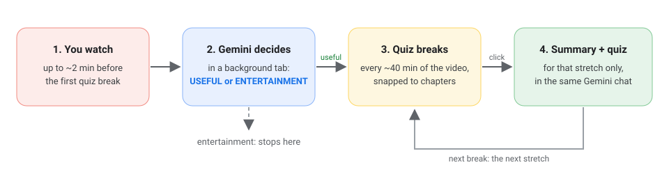
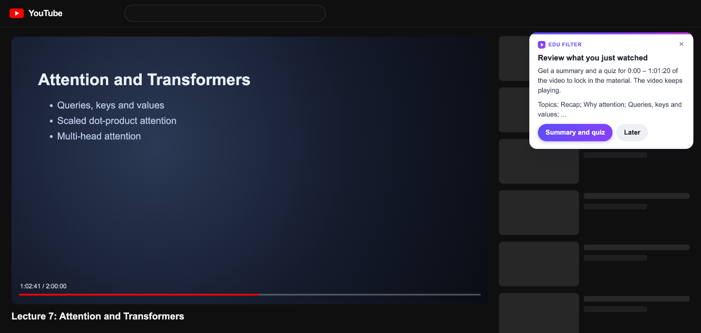
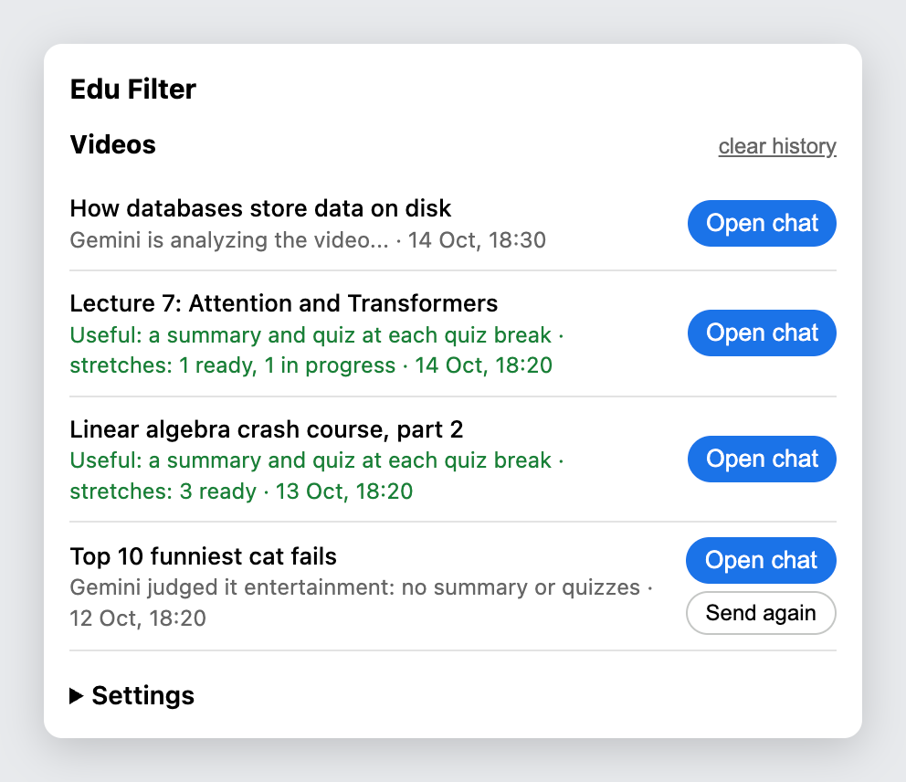
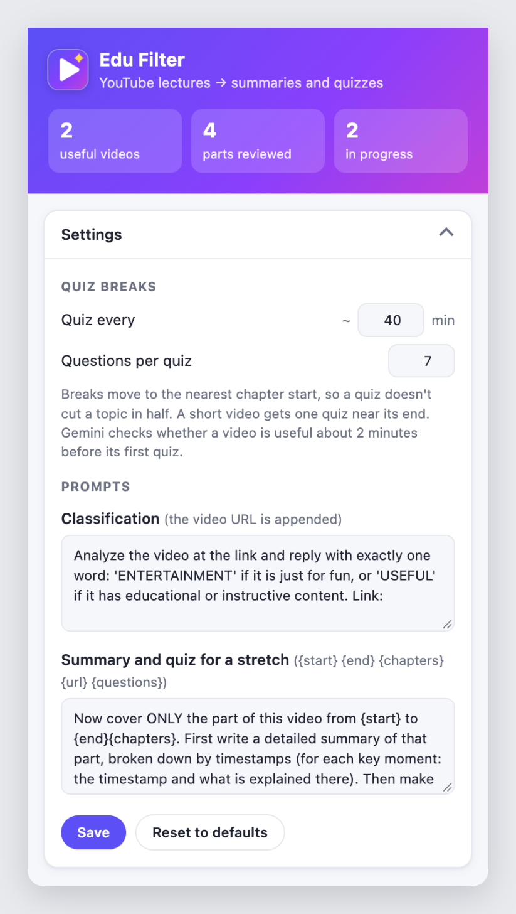

# Edu Filter

**Remember the lectures you watch.** A Chrome extension that adds quiz breaks to long YouTube lectures: every ~40 minutes, a summary and an interactive quiz in Google Gemini.


https://github.com/user-attachments/assets/fd4e0c6f-3b4d-407b-8fb6-6d99a0d70441

## Why

We spend hours on great lectures, and within days most of it is gone. Education is the best thing in the world, so everything you learn deserves to stick. Testing yourself is the most reliable way to make it stick:

- **Testing beats re-reading:** a week later, 61% recalled vs 40% ([Roediger & Karpicke, 2006](https://psychology.ecu.edu/wp-content/pv-uploads/sites/216/2019/03/Roediger-Karpicke-2006.pdf)).
- **Quizzes inside a video lecture** halved mind-wandering and improved learning ([Szpunar, Khan & Schacter, 2013](https://pmc.ncbi.nlm.nih.gov/articles/PMC3631699/)).
- **Recall builds understanding,** even on inference questions ([Karpicke & Blunt, 2011](https://www.purdue.edu/newsroom/research/2011/110120KarpickeScience.html)).

## How it works



1. **Watch** any lecture on YouTube.
2. **Gemini checks** in a background tab whether it's educational, about 2 minutes before the first break. Entertainment is left alone.
3. **A card appears at each break.** The video keeps playing.
4. **Click "Summary and quiz":** a summary by timestamps and a clickable quiz that tests understanding, not recall.

## Install

1. `git clone https://github.com/borovetsav/edu-filter.git`
2. Open `chrome://extensions`, turn on **Developer mode**, click **Load unpacked** and select the folder.
3. Sign in to [gemini.google.com](https://gemini.google.com) in the same Chrome profile.

That's it: no API key, no server, free. The extension uses the Gemini web app in your own browser.

## Screenshots



<p>
  
  
</p>

## Settings

Click the extension icon → **Settings**. Changes are saved as you type.

| Setting | Default | |
|---|---|---|
| Quiz every | ~40 min | Distance between breaks. Breaks move to the nearest chapter start, so a quiz doesn't cut a topic in half. |
| Questions per quiz | 7 | 1-20. |
| Prompts | | Classification (must ask for `USEFUL` or `ENTERTAINMENT`) and summary + quiz (placeholders `{start}` `{end}` `{chapters}` `{url}` `{questions}`). Answers are in Russian by default; change that line for another language. |

Skipping ahead past a break also shows the card; one card covers every stretch you skipped. Short videos get one card near the end.

## Troubleshooting

- **Nothing happens on YouTube.** After reloading the extension, reload the YouTube tab too. A video is processed once; use **Send again** in the popup to redo it.
- **The Gemini tab shows a status panel** in its bottom-left corner with the current step. Logs are in DevTools → Console, filter `[EduFilter]`.
- **"Timed out waiting for the input field".** You're signed out of Gemini, or a dialog covers the input.

<details>
<summary><b>Notes on automating Gemini</b></summary>

The extension drives Gemini's web interface rather than an API. Things that came up:

- In a background tab, Gemini keeps the answer hidden (`pending`, 0×0) until the tab is opened, so the script reads `textContent`, not `innerText`.
- Every answer starts with a screen-reader-only heading (`.cdk-visually-hidden`); it is skipped.
- Answer containers carry a `has-thoughts` class, so filtering by "thought" drops the answer. The answer itself is in `<message-content>`.
- Send and stop are one button in `div.send-button`, with a `submit` or `stop` class. Matching on classes works in any UI language.
- A click on send is sometimes ignored, so each send is verified and retried up to 3 times.
- Prompts are queued: a quiz request can arrive while Gemini is still answering.
- After an extension reload, the old script can no longer report back but still finishes its prompts; videos left in progress are marked as failed.

All selectors are at the top of `content_gemini.js`.

</details>

<details>
<summary><b>Project structure</b></summary>

```
manifest.json       MV3 manifest
background.js       Service worker: Gemini tabs, per-video state
content_yt.js       YouTube: quiz breaks, cards
content_gemini.js   Gemini: sends prompts, reads answers
popup.html / .js    Video history and settings
defaults.js         Default prompts and settings
```

</details>

## Limitations

- Needs a signed-in Gemini session; prompts and answers stay in your Gemini history.
- Gemini and YouTube change their pages; selectors may need updates.
